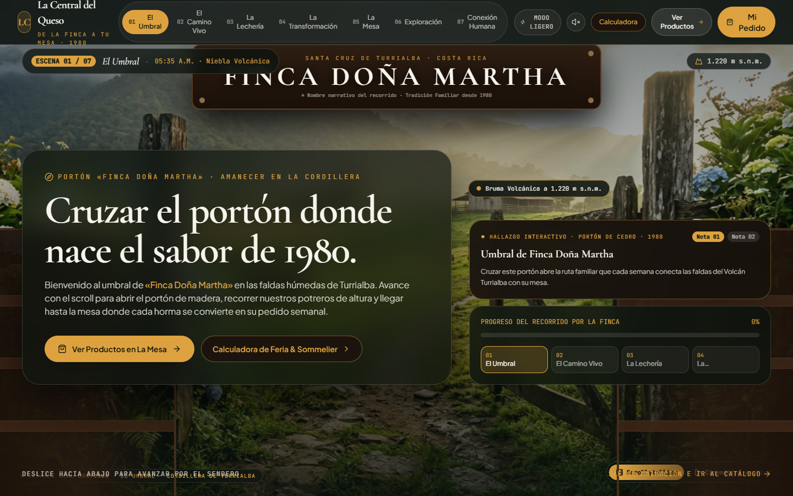
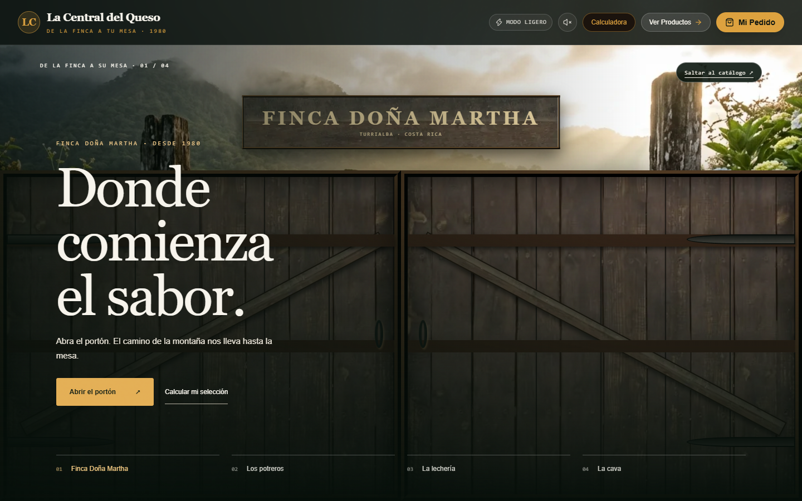
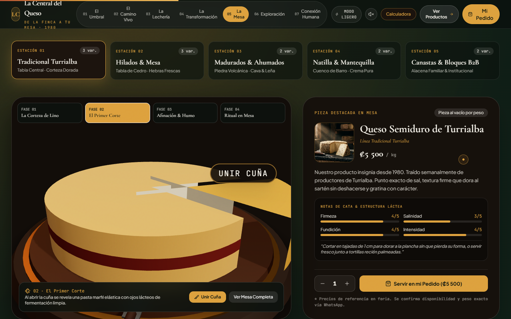
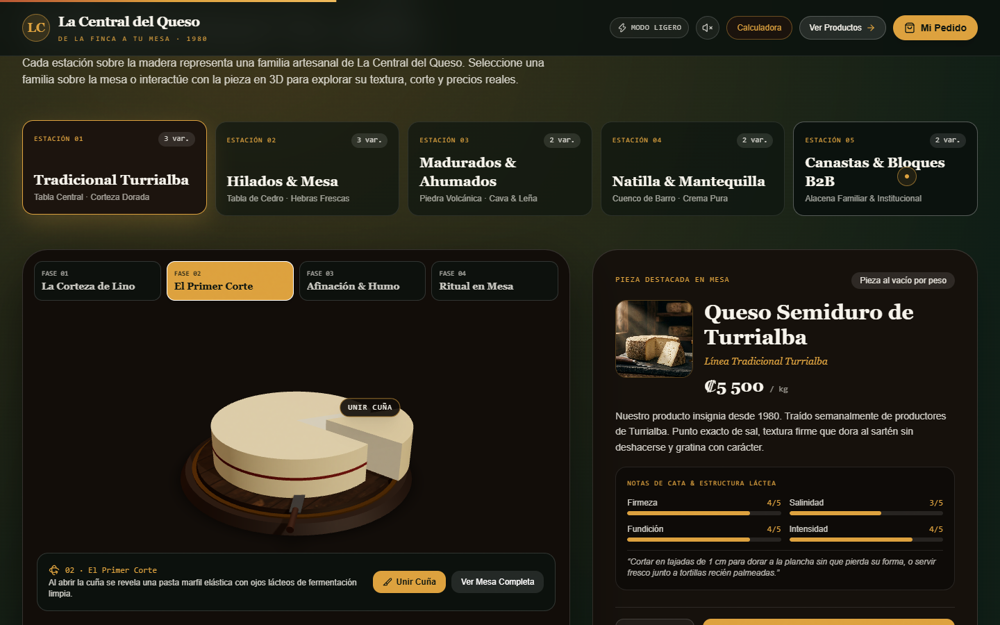
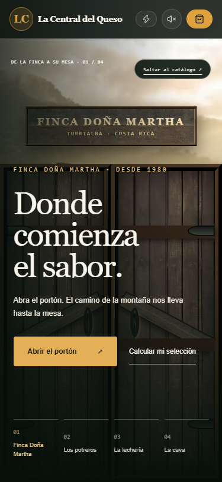
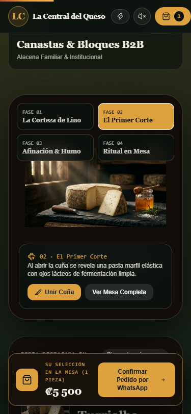

# La Central del Queso — diagnóstico y verificación

18 de octubre de 2026. Rama segura: `improve/cinematic-journey-20261018`.

- Preview protegida publicada: https://web-cd804vlhn-altiora13.vercel.app
- Preview local del código final: http://127.0.0.1:3102
- Código final de aplicación: `84af868`; código de la preview remota: `5a07d59`. La diferencia es el contenedor de desplazamiento nativo, que evita reconstruir el recorrido al iniciarse. Vercel rechazó ese último despliegue por superar 100 despliegues gratuitos diarios; indicó reintentar en 24 horas. No se cambió de plan ni se programaron reintentos.
- PR borrador: https://github.com/alvaradom1304/la-central-del-queso/pull/3
- Producción permanece en main, commit `73519f0416e9c63146662a8572b564f5b3dd6eec`. No se publicó ni se fusionó.

## Procedencia
Repositorio `alvaradom1304/la-central-del-queso`, proyecto Vercel `web`, equipo `altiora13`, raíz `.`. La sesión local de Vercel confirmó el despliegue de producción `dpl_6J2BUCNU2GPkm6bkZpJTBx6ShWB4`. La rama `hito2-exterior-realista` apunta a `39e87b0`; el código de aplicación coincide con main. Solo difieren .gitignore y PROJECT_STATUS.md.

El conector tiene visibilidad diferente de la sesión local: no encuentra web y muestra otro proyecto, `la-central-del-queso-5qyq`, con despliegues fallidos por buscar `src/web`. Se usó la sesión local para inspeccionar y crear previews explícitas. No se cambió la configuración de producción ni se desactivó su protección.

## Causas y correcciones
1. El modo ligero retiraba intencionalmente video y 3D. El video original sí aparece fuera de ese modo. El reproductor ejecutaba un solo avance amortiguado por cada evento; el segundo buffer declarado no se renderizaba. Se implementaron sincronización continua mientras la escena está visible, capítulos con transición, carga próxima al capítulo y respaldo fotográfico por clip. Playwright confirmó un fotograma decodificado y reproducción que avanza sin scroll.
2. Las puertas anteriores ocupaban 26vw cada una y nunca cerraban el centro. Las nuevas hojas ocupan toda la abertura, con madera local, bisagras exteriores, refuerzos diagonales y herrajes. Hay una segunda apertura al llegar al tramo del granero/cava. Se dio más espacio al paisaje y se corrigió el contraste del enlace de salto.
3. La cámara original recortaba la horma y la tabla. Ahora ambas caben completas; el visor tiene altura explícita y deja de dibujar fuera de vista. Las caras del corte se alinearon con el radio, eliminando las láminas sobresalientes.
4. La prueba sin WebGL encontró que el respaldo original no detenía la caída de la aplicación. Se aisló el error dentro del visor. Resultado final: fotografía presente (1), cabecera disponible (1), sin errores de página en esa prueba (0).
5. El carrito ya no sobrescribe su sesión antes de restaurarla. Tiene anuncio accesible al agregar, contención del foco, Escape y retorno de foco. Se conservaron precios, catálogo y fórmula de calculadora.
6. Se separó el motor 3D para cargarlo al elegir la inspección. El primer póster pasó de 1.064.286 bytes a 249.382 en escritorio y 88.568 en móvil; se precarga y se sirve por tamaño. El recorrido fotográfico se entrega desde el servidor, con altura reservada durante la hidratación. Se retiraron actualizaciones de puntero sin uso y las cintas respetan movimiento reducido. Se usa desplazamiento nativo para conservar el árbol servido por el servidor. Las texturas de las puertas pasan a WebP (14.650 y 20.082 bytes).

## Pruebas
El código final se compiló en modo producción local y se probó a través de su servidor. La versión remota anterior aprobó también 23 controles; después se comprobaron los assets optimizados de la última preview remota a 1440, 375 y 768 píxeles.

23 de 23 controles aprobados; fallos: ninguno. Error fatal del guion: no.

- Puertas cerradas, apertura de entrada, segunda apertura y avance real de video.
- Corte de cuña, visor 3D y regreso tras desplazarse a otra sección.
- Agregar al carrito, foco dentro del diálogo, Escape y restauración tras recargar.
- Calculadora para dos personas: ₡11.200. Al sumarla a una pieza previa de ₡5.500, carrito: ₡16.700.
- Escritorio 1440×900, móvil 375×812 y tablet 768×812; sin desbordamiento horizontal ni cabecera recortada. Compra probada en ambas vistas pequeñas.
- Movimiento reducido: sin puertas ni video; elección manual del modo completo probada.
- Simulación sin WebGL: fotografía y funciones comerciales accesibles.
- Errores de página: 0. Respuestas HTTP fallidas: 0. Se mantienen advertencias de deprecación de Three.js y utilidades existentes.
- Compilación de producción y tipos aprobados en Vercel. No se enviaron pedidos reales, formularios comerciales ni mensajes de WhatsApp.

## Rendimiento medido y límites
Chrome headless en Windows, sin limitación artificial de CPU o red. La prueba completa final usa la compilación local a 1440×900. La prueba remota utiliza autenticación temporal restringida al origen de Vercel. Son observaciones locales, no datos de visitantes ni p75.

- LCP observado al inicio en local: 2388 ms.
- LCP observado en la última preview remota: escritorio 4.736 ms, móvil 3.200 ms y tablet 10.604 ms, con suma de cambios iniciales 0 en esas visitas. Estas muestras están fuera del objetivo LCP; no se declara optimizado el rendimiento de campo.
- Suma de cambios de diseño sin entrada reciente: 0; es una suma del observador, no un cálculo completo de ventanas CLS.
- JavaScript transferido al inicio (encodedBodySize): 178238 bytes.
- Mayor duración de evento registrada en el tramo posterior a recargar: 2624 ms; no equivale a INP de campo.
- Objetivos del protocolo: LCP ≤2,5 s, CLS ≤0,1 e INP ≤200 ms en p75. No se declara alcanzado el p75. Las muestras previas variaron de 1,42 a 6,38 s según recarga/conexión; no se atribuyen diferencias a una sola causa.

El metraje sigue siendo cuatro clips distintos. El montaje es más fluido, pero una cámara realmente continua por la finca necesita material coherente adicional. La horma es una representación estilizada, no una reproducción exacta de cada variedad. No se generaron ni compraron assets. Su procedencia y derechos originales no se validaron de forma independiente.

Falta aprobación humana de dirección de arte según el protocolo; no se autoriza producción por esta revisión.

## Evidencia y skills
Capturas antes/después a 1440×900, capturas móviles, calculadora, carrito y fallback en esta carpeta. Las capturas con prefijo local- corresponden al código final. Resultados completos: browser-verification-local.json, browser-verification-hosted.json, asset-verification.json y webgl-fallback-verification-local.json. Storyboard, comparación de técnicas y manifiesto: docs/CINEMATIC-REVIEW-20261018.md y docs/cinematic-assets.json del PR.

Se aplicaron Elite Web Experience OS, el protocolo de mejora visual de Altiora, el IMMERSIVE-QUALITY-PROTOCOL solicitado, Altiora Quality Review, Vercel CLI y Access Protected Vercel Deployment. Se consultó webapp-testing; se usó el Playwright Node disponible porque Python Playwright no estaba instalado. El cambio de tecnología fue autorizado expresamente por el usuario. No se lanzaron subagentes.

## Plan ejecutado
1. Comprobar repositorio, ramas, despliegue público y duplicidad de proyectos.
2. Capturar la experiencia original y probar puertas/video/visor como casos concretos.
3. Integrar montaje híbrido con fotos, video, puertas CSS y 3D bajo demanda.
4. Proteger cálculo, pedido, teclado y alternativas reducida/sin WebGL.
5. Medir, corregir defectos reproducibles, comparar a igual resolución y dejar rama/PR/preview revisables.

## Storyboard and camera path
- 0–16%: two closed textured entry leaves swing on outer hinges; slow forward scale; nameplate Finca Doña Martha.
- 16–25%: reveal landscape and clear the timber frame.
- 25–50%: pasture chapter; gentle forward dolly and 700ms crossfade.
- 50–76%: dairy chapter; approach the craft process.
- 76–100%: cellar and second door opening; warm dark timber transition, reveal the tasting table through ordinary document scroll.
- Following sections: persistent document-flow table, family selection, interactive cut, prices, catalog and calculator. Direct skip remains available throughout.
- Reduced motion: no doors, video or dolly; photographs and direct navigation.

## Technique comparison
A. Existing compressed MP4 + poster + CSS hinged doors: chosen for immediate reuse, low dependency cost, per-clip fallbacks and inspectable source. Existing clips total 35,084,629 bytes; loading all four eagerly was avoided.
B. Scroll image sequence: not chosen because no matched frame sequence is supplied, extraction expands asset count and requires a measured mobile memory/network budget. It would not repair inconsistent source cinematography by itself.
C. Full procedural farm: not chosen for noninteractive travel; current assets do not establish photographic vegetation/material continuity. Keep WebGL for the interactive product only.
No new library, paid generation, stock purchase or external service was introduced. Existing package versions are in package-lock.json. Existing assets retain their current provenance; redistribution rights have not been independently established.

## Comparación visual en la misma resolución

Portada original y revisada a 1440×900. Las capturas finales corresponden al código local, que incluye el último ajuste de desplazamiento.

