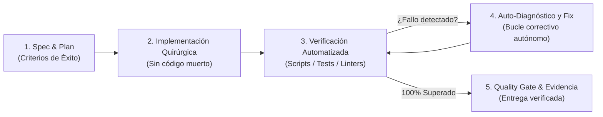

# Protocolo Universal Superpowers & Quality Gate — Altiora OS

Este estándar es de cumplimiento estricto y mandatorio para todos los agentes del ecosistema Orca (**Antigravity**, **Claude Code**, **Codex** y subagentes). Implementa el patrón **Superpowers** de ingeniería autónoma de élite: planificación sistemática, verificación orientada a pruebas y validación inmutable de calidad antes de cualquier entrega.

---

## 1. El Bucle de Ingeniería Superpowers (5 Fases)

### Fase 1: Spec & Plan (Especificación Previa)
- Antes de modificar código, define los criterios exactos de aceptación:
  - ¿Qué función o flujo específico debe cambiar?
  - ¿Qué archivo exacto se modificará?
  - ¿Qué comando verificará que el cambio funciona sin romper nada?
- Nunca comiences a codificar a ciegas sin un objetivo medible.

### Fase 2: Implementación Quirúrgica
- Realiza cambios delimitados en las líneas exactas identificadas por Graphify o por lecturas acotadas.
- Preserva la arquitectura existente, comentarios esenciales y tipado estricto.
- Prohibido dejar `console.log` huérfanos, bloques de código comentado o dependencias no instaladas.

### Fase 3: Verificación Automatizada
- Ejecuta pruebas deterministas:
  - Sintaxis y compilación: `tsc --noEmit` o pruebas unitarias de Node / Python.
  - Linters y formato: validación de sintaxis JSON, CSS y HTML.
  - Ejecución funcional: scripts de validación con salida estándar (`stdout`) y código de salida `0`.

### Fase 4: Auto-Corrección y Resiliencia
- Si un comando o prueba falla:
  - **No consultes al usuario por errores triviales.**
  - Lee el traceback completo del error (`stderr`).
  - Identifica la causa raíz (ej. importación faltante, tipado incorrecto, ruta relativa errónea).
  - Aplica la corrección quirúrgica y vuelve a ejecutar la prueba hasta que pase con éxito.

### Fase 5: Quality Gate & Evidencia Inmutable
- Ningún hito o tarea se marca como finalizado sin evidencia ejecutable.
- Todo reporte de entrega debe incluir:
  1. **Comando ejecutado:** (ej. `python scripts/verify-integrity.py`).
  2. **Resultado exacto:** (código de salida y líneas clave de salida).
  3. **Estado de lo no evaluado:** Marcar explícitamente como `NOT_RUN` cualquier aspecto fuera del alcance en lugar de asumir que funciona.

---

## 2. Lista de Comprobación del Quality Gate (Checklist Mandatorio)

| Dimensión | Requisito Mandatorio | Método de Verificación |
| :--- | :--- | :--- |
| **Sintaxis & Tipos** | Cero errores de TypeScript o compilación. | `npm run build` o script de validación sintáctica. |
| **Higiene de Git** | Estado de trabajo limpio, archivos sensibles excluidos por `.claudeignore` y `.gitignore`. | `git status` reporta árbol limpio. |
| **Knowledge Graph** | Nodos y aristas sincronizados tras cambios estructurales. | `graphify update .` ejecutado silenciosamente (`GRAPHIFY_BACKEND=none`). |
| **Seguridad OWASP** | Sin secretos en código, desinfección de entradas y URLs seguras. | Auditoría interna de credenciales y endpoints. |
| **UX & Rendimiento** | Cero parpadeos, tiempos de carga óptimos, diseño responsive móvil probado. | Inspección de layout y emulación en resoluciones 375px y 1440px. |

---

## 3. Principio de No Fricción con el Usuario
- El usuario contrata a Altiora para resolver problemas con máxima autonomía.
- Pedir confirmación para nombres de variables, rutas de imports o corrección de sintaxis destruye el valor del agente.
- La confirmación solo se solicita ante:
  1. Decisiones de inversión monetaria real.
  2. Cambios destructivos irreversibles de datos productivos.
  3. Dudas de requerimientos de negocio de alto impacto.
